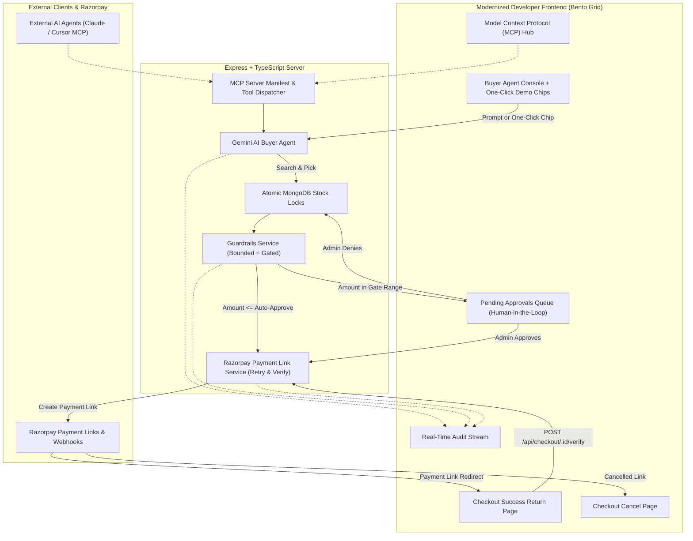

# Implementation Plan: Elevating `agentic-catalog` (Razorpay) to `agentic-commerce` (PayPal) Parity

This document outlines a phased implementation roadmap to upgrade **`agentic-catalog`** (built for the Razorpay hackathon) by porting over the advanced architectural features, safety systems, protocol integrations, and modern UI/UX design patterns pioneered in **`agentic-commerce`** (built for the PayPal AI hackathon), tailored specifically for Razorpay.

---

## 1. Executive Summary & Gap Analysis

| Feature Area | `agentic-catalog` (Current Razorpay) | `agentic-commerce` (PayPal Reference) | Target Upgrade for Razorpay |
| :--- | :--- | :--- | :--- |
| **Model Context Protocol (MCP)** | ❌ None | ✅ Full MCP server (`v2024-11-05`), 6 tools, prompts, resources, manifest, direct execution API | 🚀 Implement native MCP server with 6 tools adapted for Razorpay (`/api/mcp`) |
| **Human-in-the-Loop (HITL)** | ⚠️ Schema has `pending_approval`, but **no approve/deny APIs** or review queue | ✅ Complete review queue (`/api/checkout/pending`, `approve`, `deny`), stock hold & release, live counter | 🚀 Implement pending queue API, store manager approval actions, and frontend management portal |
| **Checkout Lifecycle & Redirects** | ⚠️ Creates payment link without `callback_url` or return handling | ✅ Dedicated `/checkout/success` (auto-capture) and `/checkout/cancel` (inventory release) | 🚀 Configure Razorpay `callback_url`, create `CheckoutSuccess` & `CheckoutCancel` pages with signature verification |
| **Interactive Demo Scenarios** | ❌ Manual text typing only | ✅ 4 one-click test chips (Happy Path, Review Gate, Safety Cap Rejection, Zero-Stock) | 🚀 Add one-click test chips calibrated in INR to easily demonstrate edge cases to judges |
| **UI/UX & Design System** | ⚠️ Classic side-nav, Picsum placeholder images, basic cards | ✅ Obsidian Bento grid, top glassmorphic command bar, metric pills, curated Unsplash imagery | 🚀 Modernize to Bento grid developer UI, top navigation with live badge counts, curated fashion imagery |
| **CORS & Cloud Deployment** | ⚠️ Strict localhost CORS, no deployment template | ✅ Multi-origin/MCP CORS support, `render.yaml` for one-click full-stack deployment | 🚀 Support wildcard/MCP CORS and add `render.yaml` for cloud deployment |

---

## 2. Architecture Comparison



---

## 3. Phased Implementation Roadmap

### Phase 1: Human-in-the-Loop (HITL) Approval System — [COMPLETED]
**Goal:** Transform the dormant `pending_approval` state into an actionable, fully-audited approval workflow.

1. **Backend Endpoints (`server/src/controllers/checkout.controller.ts` & `routes/checkout.routes.ts`)**:
   - `GET /api/checkout/pending`: Returns all orders with status `pending_approval` sorted by `createdAt: -1`.
   - `POST /api/checkout/:orderId/approve`:
     - Verifies order is in `pending_approval`.
     - Issues a Razorpay Payment Link using `createPaymentLinkWithRetry`.
     - Updates order status to `awaiting_payment` and saves Razorpay payment link details.
     - Logs audit event: `actor: 'admin-approval'`, `action: 'gate'`, `decision: 'approved_by_admin'`.
   - `POST /api/checkout/:orderId/deny`:
     - Releases atomically reserved stock via `releaseStock(productId, quantity)`.
     - Updates order status to `rejected` with `rejectionReason`.
     - Logs audit event: `actor: 'admin-approval'`, `action: 'gate'`, `decision: 'denied_by_admin'`.
   - `GET /api/checkout/:orderId`: Fetch single order by ID.

2. **Frontend Review Queue (`client/src/pages/PendingApprovals.tsx`)**:
   - Displays real-time list of held orders with item snapshot, customer name, price, and guardrail reasoning.
   - Action buttons: **[Approve & Issue Razorpay Link]** and **[Deny & Release Stock]**.
   - Live badge counter in navigation bar polled every 8 seconds.
   - Inline feedback displaying generated Razorpay payment link when approved.

---

### Phase 2: Model Context Protocol (MCP) Integration — [COMPLETED]
**Goal:** Expose the store to external AI agents (Claude Desktop, Cursor, external LLMs) via standard MCP protocols.

1. **MCP Core Engine (`server/src/mcp/manifest.ts`)**:
   - Defined MCP Schema `v2024-11-05` and manifest.
   - Registered 6 core tools:
     - `search_catalog`: Search clothes by keywords, category, and budget (in INR).
     - `get_product_details`: Query live stock levels and SKU attributes.
     - `create_guarded_checkout`: Atomically locks stock and enforces spending guardrails.
     - `run_gemini_buyer_agent`: Conversational agent execution.
     - `inspect_audit_trail`: Audit trail verification.
     - `manage_pending_approval`: Review queue actions (`list`, `approve`, `deny`).
   - Defined sample Prompts (`autonomous_purchase`, `audit_verification`) and Resources (`catalog://inventory`, `guardrails://policy`).
   - Implemented direct tool execution dispatcher `executeMcpTool(name, args)`.

2. **MCP Routes (`server/src/routes/mcp.routes.ts`)**:
   - `GET /api/mcp` and `GET /api/mcp/manifest`: Return manifest.
   - `GET /api/mcp/tools`: Return tool specifications.
   - `POST /api/mcp/tools/:toolName`: Direct tool execution.
   - `POST /api/mcp/execute`: JSON-RPC / tool-runner format.

3. **Frontend MCP Hub (`client/src/pages/McpDocs.tsx`)**:
   - Interactive schema documentation with tabs for Tools, Prompts, and Resources.
   - **Interactive Tool Runner**: Test executing any MCP tool directly within the browser with sample payloads.
   - Ready-to-copy `claude_desktop_config.json` snippet.

---

### Phase 3: Razorpay Checkout Redirects & End-to-End Payment Lifecycle — [COMPLETED]
**Goal:** Close the checkout loop so customers are redirected back to dedicated success/cancel views with signature verification.

1. **Payment Link Configuration (`server/src/services/razorpay.service.ts`)**:
   - Added `callback_url` & `callback_method: 'get'` to `razorpay.paymentLink.create` pointing to `${config.clientUrl}/checkout/success?referenceId=...`.
   - Added `fetchPaymentLink(paymentLinkId)` helper for programmatic status verification.
2. **Payment Verification & Cancellation Endpoints (`server/src/controllers/checkout.controller.ts`)**:
   - `POST /api/checkout/:orderId/verify` (and `/capture`): Verifies payment parameters or polls `paymentLink.fetch()`, sets status to `paid`, stores `paymentId`, and logs audit trail.
   - `POST /api/checkout/:orderId/cancel`: Releases reserved inventory atomically, sets status to `cancelled`, and logs audit trail.
3. **Frontend Return Pages**:
   - `client/src/pages/CheckoutSuccess.tsx`: Shows order confirmation, Razorpay payment ID, line items, and a button to view the audit trail.
   - `client/src/pages/CheckoutCancel.tsx`: Shows cancellation notification, automatically invokes cancellation to release stock, and provides navigation back to console or catalog.
   - Wired up return routing in `client/src/App.tsx`.

---

### Phase 4: Interactive Demo Scenarios & Bento Grid UI/UX — [COMPLETED]
**Goal:** Elevate presentation quality for hackathon judges and evaluators.

1. **One-Click Demo Chips (`client/src/components/BuyerAgentConsole.tsx`)**:
   - ⚡ **Happy Path (₹1,499):** `"Classic black hoodie under 2000 rupees"` (Alex Chen) &rarr; Auto-proceeds to Razorpay link.
   - 🛡️ **Approval Gate (₹14,999):** `"Designer suede jacket under 16000 rupees"` (Samantha Reed) &rarr; Holds in pending queue.
   - 🛑 **Safety Cap Rejection (₹65,000):** `"Bespoke royal silk ensemble under 70000 rupees"` (Marcus Vance) &rarr; Bounded cap rejection & stock release.
   - 📦 **Zero-Stock Recovery:** `"Tan chore coat under 3000 rupees"` (Elena Rostova) &rarr; Tests optimistic lock when stock is 0.
   - Dynamic 4-state visual progress stepper (`pending`, `running`, `done`, `error`, `skipped`).
2. **Bento Grid Layout & Styling (`Dashboard.tsx`, `App.tsx`, `tailwind.config.ts`, `globals.css`)**:
   - Top command header with Razorpay/Studio Loom branding, navigation tabs with live pending badge, and connection health pill.
   - Bento metric pills (Gemini Model, Razorpay Mode, Guardrail Bounds, Atomic Stock Concurrency).
   - Upgraded `AuditTrail.tsx` with glowing telemetry nodes, expanded JSON payload inspection, and smooth animations.
   - Curated high-resolution Unsplash fashion images in `seedCatalog.ts`.

---

### Phase 5: Cloud Deployment & Hardening — [COMPLETED]
1. Added `render.yaml` blueprint for 1-click cloud deployment (Express Web Service + Vite Static Site).
2. Updated CORS in `server/src/index.ts` to support multi-origin environments and external MCP clients.
3. Overhauled `README.md` with upgraded architecture diagram, new API tables, MCP setup guide, and one-click demo scenarios.

---

## 4. Key Files to Modify & Create

```
agentic-catalog/
├── client/
│   ├── src/
│   │   ├── api/client.ts              # Add pending, approve, deny, verify, MCP API calls
│   │   ├── components/
│   │   │   ├── BuyerAgentConsole.tsx  # Add demo chips, running state, Razorpay styling
│   │   │   └── AuditTrail.tsx         # Add glowing nodes, payload inspector
│   │   ├── pages/
│   │   │   ├── Dashboard.tsx          # Add Bento grid top metrics
│   │   │   ├── PendingApprovals.tsx   # [NEW] Human-in-the-loop queue
│   │   │   ├── McpDocs.tsx            # [NEW] Model Context Protocol interactive hub
│   │   │   ├── CheckoutSuccess.tsx    # [NEW] Razorpay return redirect page
│   │   │   └── CheckoutCancel.tsx     # [NEW] Razorpay cancellation page
│   │   ├── styles/globals.css         # Tech grid, dark scrollbars
│   │   └── App.tsx                    # Glassmorphic top navigation bar & router
├── server/
│   ├── src/
│   │   ├── controllers/checkout.controller.ts  # Add pending, approve, deny, verify
│   │   ├── mcp/
│   │   │   └── manifest.ts            # [NEW] MCP manifest, tools, execution dispatcher
│   │   ├── routes/
│   │   │   ├── checkout.routes.ts     # Add /pending, /approve, /deny, /verify
│   │   │   └── mcp.routes.ts          # [NEW] /api/mcp routes
│   │   ├── services/razorpay.service.ts # Add callback_url & payment link fetch/verify
│   │   └── index.ts                   # Mount /api/mcp & configure CORS
│   ├── scripts/seedCatalog.ts         # Add high-res fashion imagery & calibrated prices
└── render.yaml                        # [NEW] Render blueprint for full-stack deployment
```
