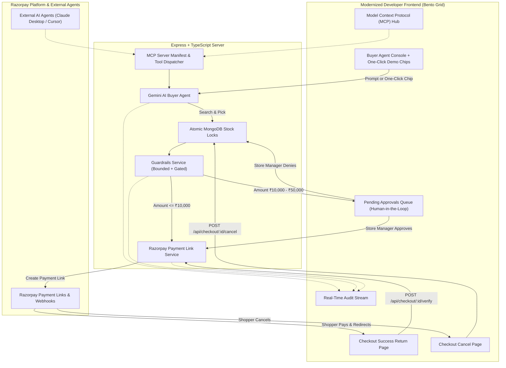

# Agentic Catalog — Studio Loom (Razorpay Edition)

Studio Loom is an autonomous, agent-ready commerce storefront built for the **Razorpay Buildathon**. A shopper expresses what they want in natural language; a Gemini-powered AI buyer agent parses shopper intent, queries catalog inventory, verifies stock atomically, applies spending guardrails, and issues a **Razorpay Payment Link**. Every decision is visible in an immutable, real-time audit trail.

[](LICENSE)
[](http://localhost:5000/api/mcp/manifest)
[](https://razorpay.com/docs/api/payments/payment-links/)

---

## Why Agentic Commerce Needs Guardrails

Agentic commerce demands more than simple product retrieval. Studio Loom makes the end-to-end autonomous purchasing path safe, auditable, and resilient:

- **Model Context Protocol (MCP) Integration:** Standardized `v2024-11-05` tools, prompts, and resources allowing external AI agents (Claude Desktop, Cursor, OpenAI Swarm, Gemini SDK) to search inventory and initiate guarded purchases.
- **Atomic Stock Reservation:** Optimistic database locks guarantee concurrent requests cannot oversell limited inventory.
- **Autonomous Spending Guardrails & HITL Review Queue:**
  - `<= ₹10,000`: Auto-proceeds to generate Razorpay Payment Link.
  - `₹10,000 - ₹50,000`: Reserved atomically and held in the **Human-in-the-Loop Review Queue** for store manager authorization.
  - `> ₹50,000`: Automatically rejected by hard safety cap with immediate stock release.
- **Resilient Razorpay Integration:** Payment Link generation with timeout, automatic retry, post-checkout redirect loop (`/checkout/success` and `/checkout/cancel`), signature verification, and webhook handling with stock release on failure.
- **Explainable Real-Time Audit Stream:** Live telemetry displaying intent parsing, catalog candidate scoring, atomic locks, guardrail evaluations, and Razorpay transaction states.

---

## Architecture Flow



---

## Interactive Demo Scenarios (One-Click Testing)

In the frontend Agent Console, click any pre-configured scenario chip to test edge cases instantly:

1. ⚡ **Happy Path (₹1,499):** `"Classic black hoodie under 2000 rupees"` &rarr; Autonomous intent parsing &rarr; Atomic lock &rarr; Razorpay test payment link created immediately with payment button.
2. 🛡️ **Approval Gate (₹14,999):** `"Designer suede jacket under 16000 rupees"` &rarr; Stock reserved &rarr; Held in the **Review Queue** for store manager authorization &rarr; Manager clicks **[Approve & Issue Razorpay Link]**.
3. 🛑 **Hard Cap Rejection (₹65,000):** `"Bespoke royal silk ensemble under 70000 rupees"` &rarr; Guardrail triggers hard rejection &rarr; Stock instantly released back to catalog &rarr; Telemetry logged.
4. 📦 **Zero-Stock Recovery:** `"Tan chore coat under 3000 rupees"` &rarr; Tests optimistic lock when item inventory is 0.

---

## Tech Stack

- **Frontend:** React 18, TypeScript, Vite, Tailwind CSS (Obsidian Dark & Bento Grid Developer Theme)
- **Backend:** Node.js, Express, TypeScript, Mongoose, MongoDB Atlas
- **AI / LLM:** Google Gemini structured JSON output (`gemini-2.5-flash` / `gemini-1.5-flash`)
- **Protocol:** Model Context Protocol (MCP) server manifest (`v2024-11-05`)
- **Payments:** Razorpay Test Mode Payment Links and Webhooks

---

## Local Setup & Quickstart

### 1. Install Dependencies
```bash
npm install
```

### 2. Configure Environment Variables
Create `server/.env`:
```env
PORT=5000
NODE_ENV=development
CLIENT_URL=http://localhost:5173

MONGODB_URI=mongodb+srv://<user>:<password>@cluster0.mongodb.net/agentic-catalog?retryWrites=true&w=majority

# Razorpay Test Mode Keys (Dashboard > Account & Settings > API Keys)
RAZORPAY_KEY_ID=rzp_test_xxxxxxxxxxxx
RAZORPAY_KEY_SECRET=xxxxxxxxxxxxxxxxxxxx
RAZORPAY_WEBHOOK_SECRET=xxxxxxxxxxxxxxxxxxxx

# AI Agent (Google Gemini)
LLM_API_KEY=your_gemini_api_key
LLM_PROVIDER=gemini
LLM_MODEL=gemini-2.5-flash

# Guardrails (in INR)
APPROVAL_THRESHOLD=10000
MAX_ORDER_VALUE=50000
```

Create `client/.env`:
```env
VITE_API_BASE_URL=http://localhost:5000/api
```

### 3. Seed Catalog
```bash
npm run seed
```

### 4. Run Development Servers
```bash
npm run dev
```
- Frontend: `http://localhost:5173`
- Backend: `http://localhost:5000`

---

## Model Context Protocol (MCP) Integration

Studio Loom exposes a full Model Context Protocol (MCP) server. External AI agents (such as **Claude Desktop** or **Cursor**) can connect directly by adding this to their `claude_desktop_config.json`:

```json
{
  "mcpServers": {
    "studio-loom-razorpay": {
      "command": "npx",
      "args": ["-y", "@modelcontextprotocol/server-fetch", "http://localhost:5000/api/mcp"]
    }
  }
}
```

Registered MCP Tools:
- `search_catalog`: Search clothes by keywords, category, and budget (in INR).
- `get_product_details`: Query live stock levels and SKU attributes.
- `create_guarded_checkout`: Atomically reserve stock and enforce spending guardrails.
- `run_gemini_buyer_agent`: End-to-end conversational agent execution.
- `inspect_audit_trail`: Audit trail verification.
- `manage_pending_approval`: Human-in-the-Loop review queue management.

---

## API Endpoints

| Method | Path | Description |
| :--- | :--- | :--- |
| `GET` | `/api/health` | Health check |
| `GET` | `/api/catalog` | List catalog products |
| `GET` | `/api/catalog/search?q=&maxPrice=&category=` | Search products with query & budget filter |
| `PATCH` | `/api/catalog/:id` | Update product price or stock (demo lever) |
| `POST` | `/api/checkout/:productId` | Reserve stock, check guardrails & create payment link |
| `GET` | `/api/checkout/:orderId` | Fetch order details and payment link status |
| `POST` | `/api/checkout/:orderId/verify` | Verify Razorpay payment upon return redirect |
| `POST` | `/api/checkout/:orderId/cancel` | Cancel order & release held stock back to catalog |
| `GET` | `/api/checkout/pending` | List orders held in Human-in-the-Loop review queue |
| `POST` | `/api/checkout/:orderId/approve` | Store manager approves order & generates Razorpay link |
| `POST` | `/api/checkout/:orderId/deny` | Store manager denies order & releases reserved stock |
| `POST` | `/api/agent/buy` | Run AI buyer agent with `{ want, customerName }` |
| `GET` | `/api/audit?orderId=` | Query immutable decision audit logs |
| `GET` | `/api/mcp/manifest` | Get Model Context Protocol (MCP) server manifest |
| `POST` | `/api/mcp/tools/:toolName` | Directly execute an MCP tool |
| `POST` | `/api/mcp/execute` | JSON-RPC tool invocation format |
| `POST` | `/api/webhooks/razorpay` | Receive Razorpay webhook notifications |

---

## Scripts

| Command | Purpose |
| :--- | :--- |
| `npm run dev` | Run frontend and backend concurrently |
| `npm run build` | Build client and server workspaces |
| `npm run seed` | Seed catalog with curated high-res items |
| `npm run agent -- "<want>"` | Run terminal buyer agent |
| `cd server && npm run test:race -- <productId> <n>` | Test concurrent stock reservation concurrency |
